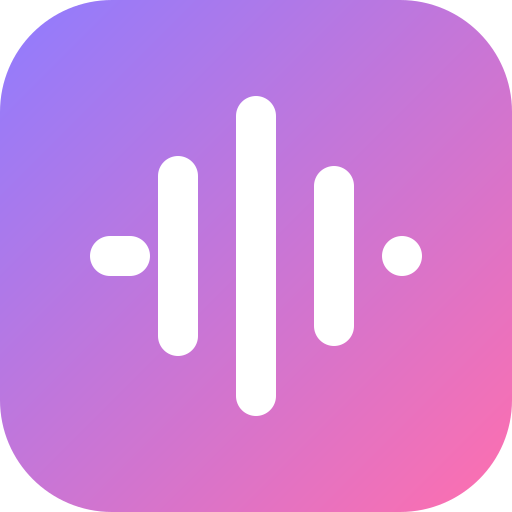
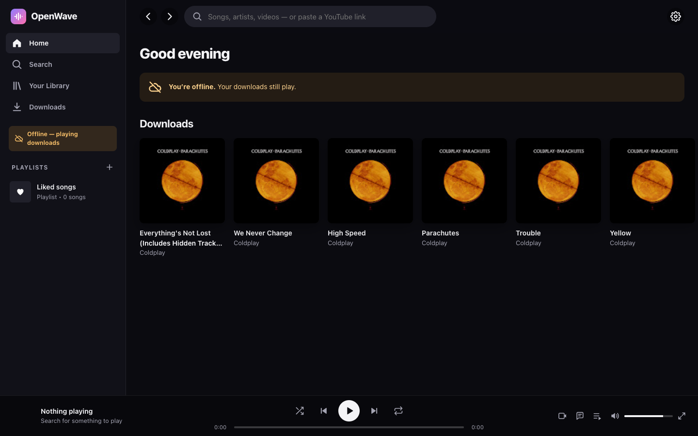

<div align="center">



# OpenWave

**A free, open-source music and video player. You can search almost anything on YouTube, play it, and download it for offline listening.**
<br>No ads. No accounts. No tracking. No premium tier.

[](https://github.com/SaiSiddharthBS/OpenWave/actions/workflows/ci.yml)
[](LICENSE)


[Features](#-features) · [Quick start](#-quick-start) · [Phone](#-use-it-on-your-phone) · [Offline](#-offline-listening) · [How it works](#-how-it-works) · [FAQ](#-faq) · [Contributing](#-contributing)


</div>

## ✨ Features

| | |
|---|---|
| 🔎 **Search YouTube** | Songs, music videos, albums, artists and playlists from YouTube Music, plus an **All of YouTube** tab for any other video. You can also paste a YouTube link. |
| 🎧 **Background playback** | Audio-only streaming saves data, keeps playing with the screen off, and works with lock-screen and media-key controls. |
| 🎬 **Song ⇄ Video toggle** | Switch between the song and its music video without losing your place. |
| ⬇️ **Offline downloads** | Save songs, albums, playlists or your liked songs, then listen with no internet. |
| 📻 **Autoplay radio** | When your queue ends, similar music keeps playing. You can also start a radio from any song or artist. |
| 🎤 **Synced lyrics** | Lyrics scroll with the music, and you can tap a line to jump to it. |
| 📚 **Your library** | Liked songs, playlists, saved albums, followed artists and history, all stored on your device. You can export and import it as a file. |
| 🎛️ **Full player** | Queue, play next, shuffle, repeat one or all, three audio-quality levels, keyboard shortcuts. The queue is still there after you reload. |
| 📱 **Installable everywhere** | A Progressive Web App for Android, iOS, Windows, macOS, Linux and ChromeOS. |
| 🔒 **Private by design** | Your devices never talk to Google directly, and the server stores nothing about you. |

<table>
  <tr>
    <td width="50%"><p align="center"><sub>Now playing with synced lyrics</sub></p></td>
    <td width="50%"><p align="center"><sub>Video mode and the up-next queue</sub></p></td>
  </tr>
  <tr>
    <td width="50%"><p align="center"><sub>Artist page</sub></p></td>
    <td width="50%"><p align="center"><sub>Offline mode with downloads</sub></p></td>
  </tr>
</table>

<p align="center">
  
  &nbsp;&nbsp;
  
</p>

## 🚀 Quick start

OpenWave is a small server plus a web app. Run the server once, on a PC, a home server or a VPS, and open it from any device.

### Option 1: one command (macOS / Linux / Windows)

You need [Python 3.10+](https://www.python.org/downloads/) and a JavaScript runtime, either [Deno](https://deno.com) or [Node.js 20+](https://nodejs.org). yt-dlp uses the runtime to solve YouTube's player challenges.

```bash
git clone https://github.com/SaiSiddharthBS/OpenWave.git
cd OpenWave
./scripts/start.sh          # Windows: scripts\start.bat
```

The first run sets everything up. Every run also updates `yt-dlp` and `ytmusicapi`, because YouTube changes often. Your browser then opens **http://localhost:8787**.

### Option 2: Docker (home server, NAS or VPS)

```bash
git clone https://github.com/SaiSiddharthBS/OpenWave.git
cd OpenWave
docker compose up -d --build
```

Once a release is tagged, a prebuilt multi-arch image (amd64 + arm64) will be published, and this will work:

```bash
docker run -d --name openwave -p 8787:8787 --restart unless-stopped ghcr.io/saisiddharthbs/openwave:latest
```

### Option 3: pip

```bash
pip install git+https://github.com/SaiSiddharthBS/OpenWave.git
openwave                    # options: --port 8787  --host 0.0.0.0  --no-browser
```

## 📱 Use it on your phone

1. Start OpenWave on your computer. It prints an address like `Your phone: http://192.168.1.20:8787`.
2. Open that address on your phone while it's on the **same Wi-Fi**.
3. Install it as an app:
   - **Android (Chrome):** use **⋮ → Install app**.
   - **iPhone (Safari):** use **Share → Add to Home Screen**.

To install it as a full app and listen offline away from home, browsers require **HTTPS**. Any of these free options work:

| Option | Command |
|---|---|
| [Tailscale](https://tailscale.com) (private, only your devices) | `tailscale serve 8787` |
| [Cloudflare Tunnel](https://developers.cloudflare.com/cloudflare-one/connections/connect-networks/) | `cloudflared tunnel --url http://localhost:8787` |
| VPS + [Caddy](https://caddyserver.com) | `caddy reverse-proxy --from your.domain --to localhost:8787` |

## ⬇️ Offline listening

- **One song:** use **⋯ → Download**.
- **A whole collection:** on an album, a playlist, Liked songs or one of your own playlists, use the **download button** next to Play.
- **Badges and storage:** downloaded songs show a ↓ badge and are listed under **Downloads**. **Settings → Downloads** shows how much space they use.
- **Without a connection:** the app still opens and plays your downloads, and skips anything that isn't downloaded.
- **Size:** downloads use your **Audio quality** setting, roughly 1 MB per minute.
- **Where they're stored:** downloads stay inside the app, in this browser on this device. Clearing the site's data removes them.

## 🧠 How it works

```
 Your phone / PC (PWA)                        OpenWave server (FastAPI)                 YouTube
┌───────────────────────────┐  /api/search   ┌───────────────────────────────┐
│ UI · queue · lyrics       │ ─────────────▶ │ ytmusicapi → search, albums,  │ ───▶ music.youtube.com
│ library (localStorage)    │  /api/album…   │   artists, radio, lyrics      │
│ downloads (IndexedDB)     │                │                               │
│ <audio> / <video>+hls.js  │  /api/stream   │ yt-dlp → stream URLs          │ ───▶ youtube.com
│ service worker (offline)  │ ◀───────────── │ byte-range proxy              │ ◀─── googlevideo.com
└───────────────────────────┘                └───────────────────────────────┘
```

- **Why a server?** YouTube ties every stream URL to the IP address that asked for it, and browsers can't call YouTube's APIs directly. The server resolves streams and proxies the bytes. It supports range requests, so seeking works.
- **Fast starts.** yt-dlp first tries a client whose URLs play immediately, so a song starts in about 3 seconds. If YouTube refuses that client, the server switches to sturdier clients in the middle of the song. The files are byte-identical, so you won't hear a glitch. The next track is fetched ahead of time, so skipping is instant.
- **Privacy.** Thumbnails go through the same proxy, so your devices never contact Google. Your library and downloads never leave your device.

<details>
<summary><b>HTTP API</b>: build your own client (interactive docs at <code>/api/docs</code>)</summary>

| Endpoint | Returns |
|---|---|
| `GET /api/search?q=&type=all\|songs\|videos\|albums\|artists\|playlists\|youtube` | normalised results |
| `GET /api/suggest?q=` | search suggestions |
| `GET /api/home` | recommendation shelves |
| `GET /api/album/{browseId}` · `/api/playlist/{id}` · `/api/artist/{channelId}` | detail pages |
| `GET /api/next/{videoId}` | radio / up-next tracks |
| `GET /api/lyrics/{videoId}` | synced or plain lyrics |
| `GET /api/stream/{videoId}?q=high\|normal\|low` | audio bytes (range requests supported) |
| `GET /api/video/{videoId}` | HLS manifest for video mode |
| `GET /api/download/{videoId}?q=` | the complete audio file (for offline downloads) |

</details>

<details>
<summary><b>Configuration</b></summary>

| Env var | Effect |
|---|---|
| `OPENWAVE_LOCATION` | Region for recommendations, e.g. `US`, `IN`, `GB` |
| `OPENWAVE_LANGUAGE` | Metadata language, e.g. `en`, `hi`, `es` |

</details>

<details>
<summary><b>Keyboard shortcuts</b></summary>

| Key | Action |
|---|---|
| `Space` / `K` | Play / pause |
| `←` / `→` | Seek 5 s |
| `Shift + ←` / `Shift + →` | Previous / next |
| `L` | Like |
| `M` | Mute |
| `S` / `R` | Shuffle / repeat |
| `/` | Search |

</details>

## ❓ FAQ

**Is it really free?**
Yes, and it always will be. There are no ads, no subscriptions and no paid features. The GPL-3.0 license means every distributed version must stay free and open source.

**Playback suddenly stopped working for everything.**
YouTube changes its internals often. Update the extractors with `pip install -U "yt-dlp[default]" ytmusicapi`. The start scripts do this automatically, and Docker users can rebuild or pull the image. **Settings → About** shows whether the server found a JavaScript runtime.

**Does it work on iPhone?**
Yes, in Safari. Use the **Normal** audio quality, which uses AAC and plays everywhere. iOS is stricter than Android about background playback for installed web apps.

**Do I need a YouTube or Google account?**
No. OpenWave never asks you to sign in.

**Can I host it for my friends or family?**
Yes. Run it with Docker on any server and put HTTPS in front of it. Each person's library and downloads stay on their own device.

## 🗺️ Roadmap

- [ ] Native Android / iOS apps (Capacitor) and desktop app (Tauri)
- [ ] Sleep timer, crossfade, equalizer
- [ ] Drag-to-reorder in the queue and playlists
- [ ] Import playlists from other services
- [ ] Translations

Ideas and help are welcome. [Open an issue](https://github.com/SaiSiddharthBS/OpenWave/issues).

## 🤝 Contributing

Contributions of any size are welcome: code, design, docs, translations and bug reports. See **[CONTRIBUTING.md](CONTRIBUTING.md)** to get started.

```bash
python -m venv .venv && .venv/bin/pip install -e ".[dev]"
.venv/bin/python -m openwave --no-browser      # http://localhost:8787
.venv/bin/pytest
```

The frontend in `openwave/web/` is plain HTML, CSS and ES modules with no build step: edit a file and reload.

## 🙏 Built with

- [yt-dlp](https://github.com/yt-dlp/yt-dlp) for stream extraction
- [ytmusicapi](https://github.com/sigma67/ytmusicapi) for the YouTube Music catalog
- [FastAPI](https://fastapi.tiangolo.com) and [httpx](https://www.python-httpx.org) for the server
- [hls.js](https://github.com/video-dev/hls.js) (Apache-2.0, vendored) for video playback
- Inspired by [NewPipe](https://newpipe.net), [FreeTube](https://freetubeapp.io) and [Invidious](https://invidious.io)

## ⚖️ Disclaimer

OpenWave is an independent project. It is **not affiliated with, endorsed by, or connected to YouTube or Google**. It hosts no content: it is a client for publicly available content, built on the same open-source libraries other community projects use. Using third-party clients may go against YouTube's Terms of Service. OpenWave is meant for personal use; please respect copyright and the artists you listen to.

## 📄 License

[GNU General Public License v3.0 or later](LICENSE).

<div align="center"><sub>Made with ♥ so that everyone can enjoy music freely.</sub></div>
