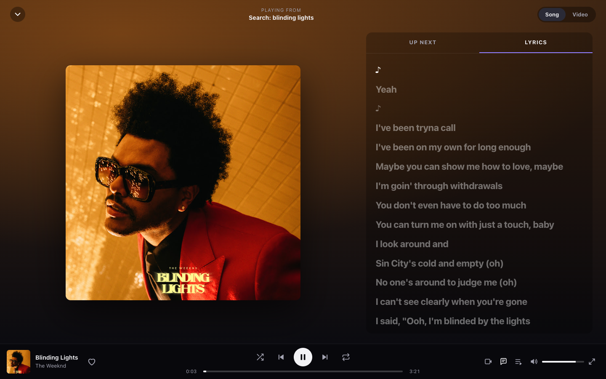
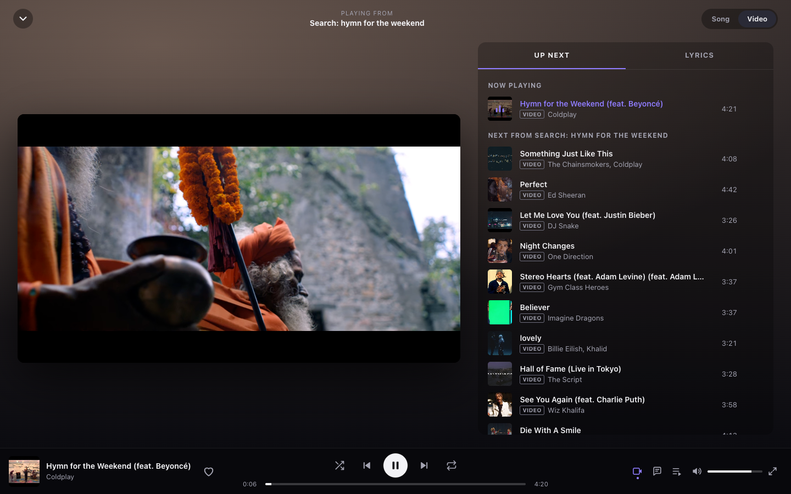

# OpenWave

**A free, open-source music and video player that uses YouTube as its backend.**
You get a Spotify / YouTube Music style app, and nothing is behind a paywall: no ads, no accounts, no tracking, no premium tier.


| Now playing with synced lyrics | Video mode with queue |
|---|---|
|  |  |

| Artist page | Phone: search | Phone: now playing |
|---|---|---|
|  |  |  |

## Features

- **Search all of YouTube.** Results come back as songs, music videos, albums, artists and playlists from YouTube Music, plus an "All of YouTube" tab for any other video. You can also paste a YouTube or YouTube Music link.
- **Plays everything in the background.** Audio-only streaming saves data, keeps playing with the screen off, and works with lock-screen and media-key controls.
- **Song ⇄ Video toggle** like YouTube Music. Switching between the two keeps your position in the track.
- **Autoplay radio.** When your queue runs out, similar songs keep playing. You can also start a radio from any song or artist.
- **Offline downloads.** You can download a song, album, playlist or your liked songs, and they play with no internet connection. The files are stored inside the app on your device, the same way Spotify's offline mode works, and the app itself opens offline too.
- **Synced lyrics** that scroll with the music when YouTube has them. Tap a line to jump to it.
- **Pages** for Home (recommendations), albums, artists (popular songs, albums, singles, videos, related artists) and playlists.
- **Your library, stored on your device:** liked songs, your own playlists, saved albums and playlists, followed artists, and history. You can export and import it as a JSON file to move it to another device.
- **Queue controls:** play next, add to queue, shuffle, repeat one or all. The queue is still there after you reload the page.
- **Audio quality setting:** High (Opus, about 160 kbps), Normal (AAC, about 128 kbps, plays everywhere) or Data saver.
- **Installable app (PWA)** on Android, iOS, Windows, macOS, Linux and ChromeOS.
- **Keyboard shortcuts:** `Space` play/pause, `←/→` seek, `Shift+←/→` previous/next, `L` like, `M` mute, `S` shuffle, `R` repeat, `/` search.

## Quick start

You need **Python 3.10+** (3.12 recommended). You also need **a JavaScript runtime**, either [Deno](https://deno.com) or Node.js 20+, because yt-dlp uses it to solve YouTube's player challenges.

### macOS / Linux

```bash
git clone <this repo> openwave && cd openwave
./scripts/start.sh
```

### Windows

```bat
git clone <this repo> openwave && cd openwave
scripts\start.bat
```

On the first run the script creates a virtualenv and installs everything. On every run it updates `yt-dlp` and `ytmusicapi`, because YouTube changes often and these libraries keep up with it. Then it opens your browser to `http://localhost:8787`.

### pip

```bash
pip install .
openwave            # options: --port 8787 --host 0.0.0.0 --no-browser
```

### Docker (good for a home server, NAS or VPS)

```bash
docker compose up -d --build     # from a clone of this repo
```

Once release images are published, one command is enough:

```bash
docker run -d --name openwave -p 8787:8787 --restart unless-stopped ghcr.io/<owner>/openwave:latest
```

To update, rebuild or pull the image. That also brings in the newest yt-dlp.

## Using it on your phone

OpenWave is a small server plus a web app, and **your phone connects to the server**:

1. Start OpenWave on your PC. It prints a line like `Your phone: http://192.168.1.20:8787`.
2. Open that address on your phone while it's on the same Wi-Fi.
3. Use **Add to Home Screen** (iOS Safari) or **Install app** (Android Chrome).

To get the full installable app on a phone, browsers require **HTTPS**. That includes opening the app and playing downloads while your phone can't reach the server. To use it away from home, any of these works:

- **[Tailscale](https://tailscale.com)**: free; `tailscale serve 8787` gives you an HTTPS URL that only your devices can reach.
- **Cloudflare Tunnel**: `cloudflared tunnel --url http://localhost:8787`.
- **A VPS** with Docker behind Caddy or nginx with a Let's Encrypt certificate.

## Offline listening

- On any song, use **⋯ → Download**. On an album, playlist, Liked songs or one of your own playlists, use the **download button** next to Play.
- Downloaded songs show a small ↓ badge and are listed under **Downloads**. **Settings → Downloads** shows how much space they use.
- With no connection, OpenWave plays only what you've downloaded and skips the rest. Search, video and recommendations come back as soon as you're online.
- Downloads use your **Audio quality** setting: about 1 MB per minute at High or Normal, less with Data saver.
- Downloads are stored in this browser on this device. Clearing the site's data removes them.

## How it works

```
 Phone / PC browser (PWA)                    OpenWave server (FastAPI)                YouTube
┌──────────────────────────┐   /api/search  ┌──────────────────────────────┐
│ Spotify-style UI         │ ─────────────▶ │ ytmusicapi  (catalog: search,│ ───▶ music.youtube.com
│ queue · lyrics · library │   /api/album…  │  home, albums, artists,      │      (public web API)
│ (library in localStorage)│                │  radio, lyrics)              │
│                          │  /api/stream   │ yt-dlp      (stream URLs)    │ ───▶ youtube.com player
│ <audio> / <video>+hls.js │ ◀───────────── │ byte-range proxy             │ ◀─── googlevideo.com
└──────────────────────────┘                └──────────────────────────────┘
```

- YouTube binds stream URLs to the IP address that requested them, so the server **proxies** the audio and video bytes. It supports HTTP range requests, so seeking works. Thumbnails go through the same proxy, so your devices never contact Google directly.
- yt-dlp first tries a client whose URLs play right away. If YouTube refuses that client, the server switches to yt-dlp's default clients in the middle of the song. Both serve byte-identical files, so playback continues without a glitch.
- The server resolves the next track in the queue (and any track you hover) ahead of time, so skipping is instant.
- Your library never leaves your browser. The server keeps no user data at all.

### API

The server is a plain JSON API, so you can build your own client on top of it (for example a native app or a CLI). Interactive docs are at `/api/docs`.

| Endpoint | What it returns |
|---|---|
| `GET /api/search?q=&type=all\|songs\|videos\|albums\|artists\|playlists\|youtube` | normalised results |
| `GET /api/suggest?q=` | search suggestions |
| `GET /api/home` | recommendation shelves |
| `GET /api/album/{browseId}` · `/api/playlist/{id}` · `/api/artist/{channelId}` | detail pages |
| `GET /api/next/{videoId}` | radio / up-next tracks |
| `GET /api/lyrics/{videoId}` | synced or plain lyrics |
| `GET /api/stream/{videoId}?q=high\|normal\|low` | audio bytes (range-capable) |
| `GET /api/video/{videoId}` | HLS manifest URL for video mode |
| `GET /api/download/{videoId}?q=` | the complete audio file in one response (used for offline downloads) |

### Configuration

| Env var | Effect |
|---|---|
| `OPENWAVE_LOCATION` | Region for recommendations, e.g. `US`, `IN`, `GB` |
| `OPENWAVE_LANGUAGE` | Language for YouTube Music metadata, e.g. `en`, `hi`, `es` |

## Development

```bash
python -m venv .venv && .venv/bin/pip install -e ".[dev]"
.venv/bin/python -m openwave --no-browser
.venv/bin/pytest
```

The frontend is plain HTML, CSS and ES modules in `openwave/web/`, with no build step: edit a file and reload. `hls.js` (Apache-2.0) is vendored in `openwave/web/vendor/`.

```
openwave/
  app.py        HTTP API, stream/image/HLS proxies, static files
  music.py      catalog via ytmusicapi, normalised into tracks and cards
  youtube.py    stream resolution via yt-dlp, caching, client fallback
  web/          the app: index.html, css/, js/ (app, player, views, ui, store, api, offline), sw.js
```

## When something breaks

YouTube changes its internals often. If playback suddenly fails for everything:

1. Update the extractors with `pip install -U "yt-dlp[default]" ytmusicapi`. The start scripts do this for you, and Docker users can rebuild the image.
2. Make sure Deno or Node is installed. **Settings → About** shows which JS runtime the server found.

## Legal

OpenWave is an independent project. It is **not affiliated with, endorsed by, or connected to YouTube or Google**, and it does not use their names or logos as its branding. It accesses publicly available content through the same open-source libraries (yt-dlp, ytmusicapi) that projects like NewPipe, FreeTube and Invidious rely on. Using third-party clients may go against YouTube's Terms of Service. Use it for personal use, at your own discretion, and respect copyright where you live. OpenWave hosts no content.

## Contributing

Contributions are very welcome. See [CONTRIBUTING.md](CONTRIBUTING.md). OpenWave will always be free, with no ads, accounts or tracking.

## License

[GNU GPL v3.0 or later](LICENSE). OpenWave is free software, and any distributed fork has to stay free and open source too.
