<div align="center">


<h1>OpenWave</h1>

<p><b>An open-source music player for every device you own.</b></p>

<p>Search YouTube Music's public catalogue, play it gaplessly, and take your library, playlists<br>and listening sessions across your Mac, PC and phone.</p>

<p>
<a href="https://github.com/SaiSiddharthBS/OpenWave/releases/latest"></a>
<a href="https://github.com/SaiSiddharthBS/OpenWave/actions/workflows/ci.yml"></a>
<a href="LICENSE"></a>

</p>

<p>
<a href="https://saisiddharthbs.github.io/OpenWave/"><b>Website</b></a> ·
<a href="#download"><b>Download</b></a> ·
<a href="#features">Features</a> ·
<a href="#architecture">Architecture</a> ·
<a href="#self-hosting">Self-hosting</a> ·
<a href="#faq">FAQ</a> ·
<a href="https://saisiddharthbs.github.io/OpenWave/stats.html">Stats</a>
</p>


</div>

<br>

## Overview

OpenWave is an open-source, non-commercial music client for YouTube Music's public catalogue. It is an engineering project first: one engine, native apps on five platforms, a synced personal library, and devices that play together. It has no accounts, no tracking and no monetisation of any kind, and it hosts no content.

- **One engine, every platform.** A single Python engine powers native apps for macOS, Windows, Linux and Android, a web app for iPhone, and a Docker image for home servers. Shared services keep the core listening and library experience consistent.
- **Your library is yours.** Profiles, likes, playlists and listening history live in a SQLite database on your own device or server. Nothing is sent to a cloud service (except an end-to-end encrypted copy of a playlist you choose to share), and the apps never report usage.
- **Built like a product, not a script.** Gapless playback, personal mixes, synced lyrics, offline downloads, playlist import from other services, shared playlists with friends anywhere, multi-device control and listen-together sessions, in-app updates, and release checksums.

<table>
  <tr><td><b>License</b></td><td>GPL-3.0. The project is offered free, with no accounts or monetisation.</td></tr>
  <tr><td><b>Account</b></td><td>None. Profiles are local, with an optional PIN.</td></tr>
  <tr><td><b>Platforms</b></td><td>macOS 13+ (Apple Silicon and Intel), Windows 10/11, Linux x86-64, Android 7+ (64-bit), iPhone via Safari, Docker (amd64, arm64)</td></tr>
  <tr><td><b>Latest release</b></td><td><a href="https://github.com/SaiSiddharthBS/OpenWave/releases/latest">Current installers</a>, SHA-256 checksums and a Docker image</td></tr>
</table>

## Download

**macOS, in one command.** Picks the Apple Silicon or Intel build, verifies its checksum, and installs it to Applications. macOS may still ask you to confirm an unsigned app at first launch.

```bash
curl -fsSL https://saisiddharthbs.github.io/OpenWave/install.sh | bash
```

| Platform | Download | First launch |
|---|---|---|
| **macOS**, Apple Silicon | [OpenWave-macOS-AppleSilicon.dmg](https://github.com/SaiSiddharthBS/OpenWave/releases/latest/download/OpenWave-macOS-AppleSilicon.dmg) | Drag to Applications. If macOS can't verify it: **System Settings → Privacy & Security → Open Anyway**, once. |
| **macOS**, Intel | [OpenWave-macOS-Intel.dmg](https://github.com/SaiSiddharthBS/OpenWave/releases/latest/download/OpenWave-macOS-Intel.dmg) | As above. |
| **Windows** 10/11 | [OpenWave-Windows-Setup.exe](https://github.com/SaiSiddharthBS/OpenWave/releases/latest/download/OpenWave-Windows-Setup.exe) | On "Windows protected your PC", choose **More info → Run anyway**. No administrator rights needed. |
| **Linux** x86-64 | [OpenWave-Linux-x86_64.AppImage](https://github.com/SaiSiddharthBS/OpenWave/releases/latest/download/OpenWave-Linux-x86_64.AppImage) | `chmod +x` the file, then open it. |
| **Android** 7+ | [OpenWave-Android.apk](https://github.com/SaiSiddharthBS/OpenWave/releases/latest/download/OpenWave-Android.apk) | Open the file and allow your browser to install apps. For automatic updates, add this repository to [Obtainium](https://github.com/ImranR98/Obtainium). |
| **iPhone** | Served by OpenWave on your Mac, PC or server | See [iPhone](#iphone). |
| **Home server** | [Docker image](#self-hosting) for amd64 and arm64 | Open `http://<server>:8787` on any device. |

Every app is self-contained, with nothing else to install. Installers are attached to each [GitHub release](https://github.com/SaiSiddharthBS/OpenWave/releases) together with `SHA256SUMS.txt`.

**Updates.** Every app checks for new releases and installs them in one step. On the Mac, the app downloads the update, verifies its checksum, replaces itself and restarts. YouTube support (yt-dlp and ytmusicapi) also updates itself in the background between releases, so playback keeps working when YouTube changes.

## Features

### Listening

- **Search almost any song** on YouTube Music: songs, albums, artists and playlists. Paste a YouTube or YouTube Music link to open it directly.
- **Songs, never videos.** OpenWave always plays the studio audio track. Music videos are swapped for their song version automatically, so there is no film dialogue, intro or skit in the middle of your music.
- **Gapless playback** with optional **crossfade** (up to 12 seconds). The next song is buffered while the current one plays, so skipping is instant.
- **Endless autoplay.** When the queue ends, similar music keeps playing, and songs you heard recently are left out.
- **Synced lyrics** that scroll with the song. Select a line to jump to it.
- **Offline downloads** of songs, albums and playlists, stored on the device.
- **Sleep timer** from 5 to 90 minutes, or to the end of the song, with a gentle fade-out.
- **Adaptive audio.** OpenWave picks the best format the device plays well (Opus or AAC, up to about 160 kbps), with a data-saver option.
- **Fast by design.** Home appears instantly from cache, songs begin loading while your finger is still on them, and the song version of a music video is found in well under a second and remembered.

<table>
  <tr>
    <td width="50%">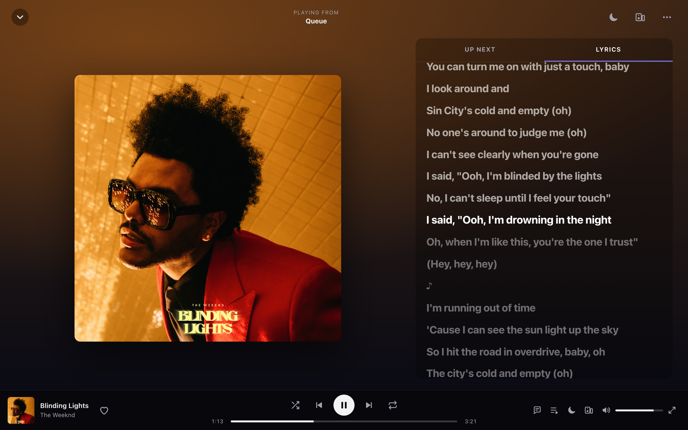<p align="center"><sub>Now playing, with synced lyrics</sub></p></td>
    <td width="50%">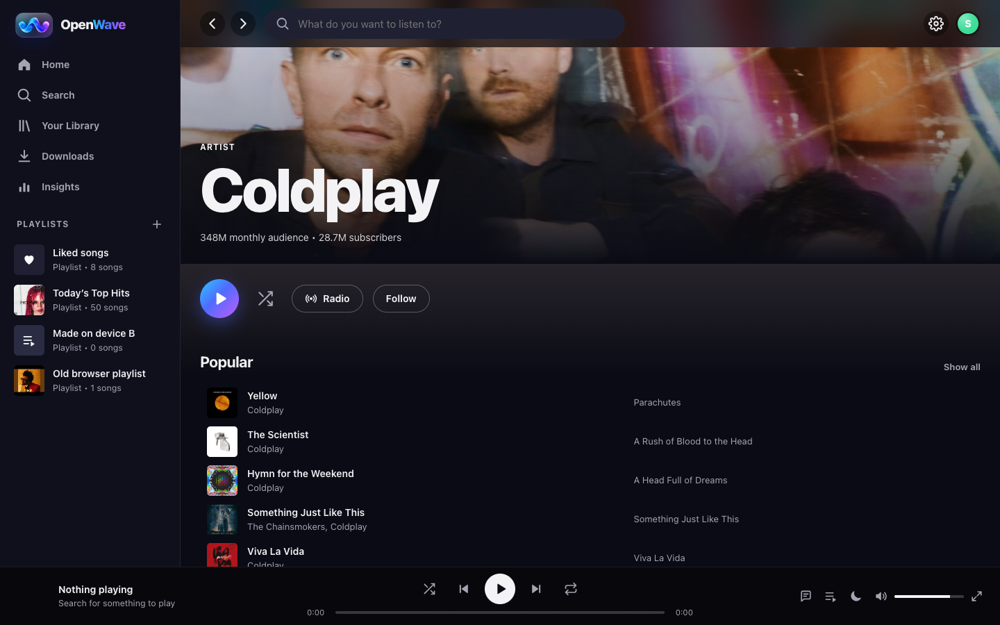<p align="center"><sub>Artist pages, radio and follow</sub></p></td>
  </tr>
</table>

### Your library, personalised

- **Profiles** for everyone in the household, each with its own likes, playlists, history and settings, and an optional PIN.
- **Sync** across every device that uses the same OpenWave. Changes apply instantly where you make them, queue up while offline, and reach your other devices within seconds.
- **Liked songs, playlists you can reorder by dragging, saved albums and followed artists.**
- **Made for you.** Personal mixes built from what you actually play, plus two smart playlists: **On Repeat** (your most-played songs this month) and **Rediscover** (favourites you haven't played in a while).
- **Insights.** Minutes listened, top artists, top songs and when you listen, for the last week, month, year or all time, with a shareable image card.
- **Shared playlists** with friends and family on their own devices, anywhere (see [below](#shared-playlists-one-playlist-everyones-devices)).
- **Share** any song, album, playlist or artist as a link anyone can open, or share your own playlist as a song list a friend can import.

<table>
  <tr>
    <td width="50%">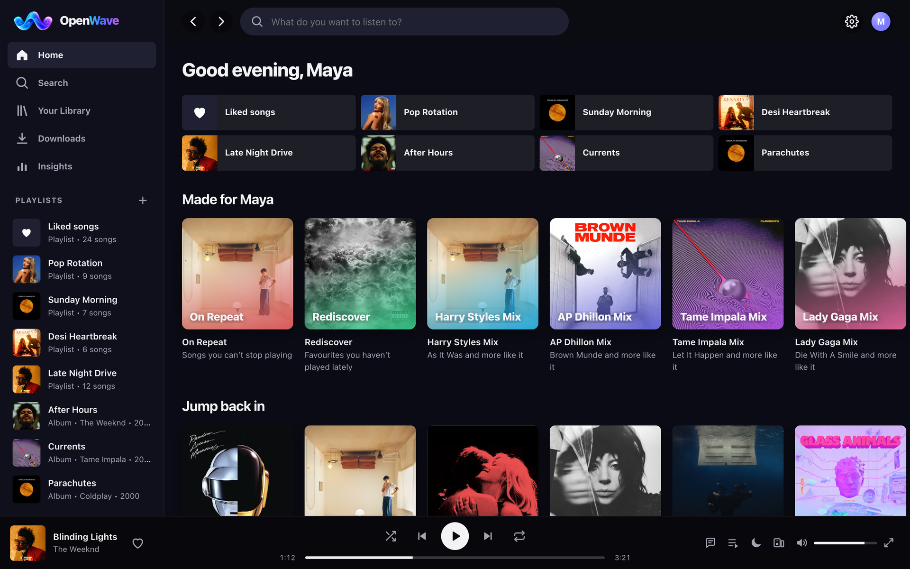<p align="center"><sub>Home: shortcuts, personal mixes and recent music</sub></p></td>
    <td width="50%">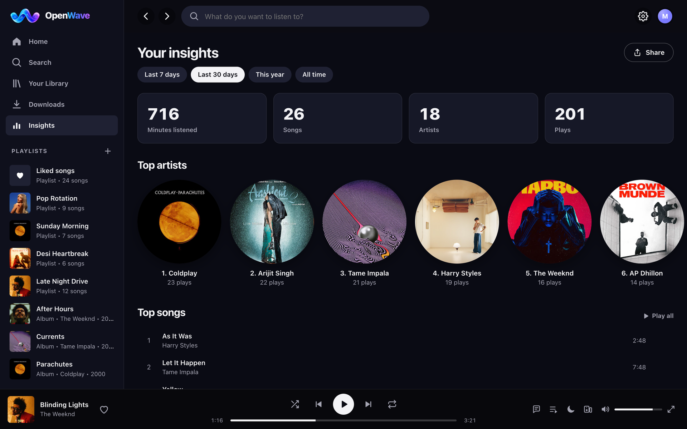<p align="center"><sub>Insights</sub></p></td>
  </tr>
  <tr>
    <td width="50%">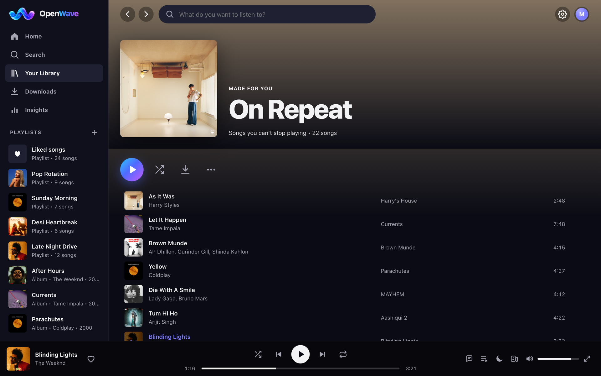<p align="center"><sub>On Repeat, built only from your own listening</sub></p></td>
    <td width="50%">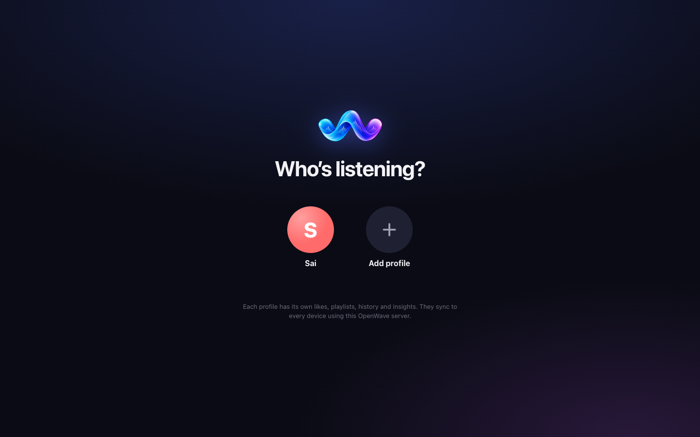<p align="center"><sub>A profile for everyone, synced everywhere</sub></p></td>
  </tr>
</table>

### Shared playlists: one playlist, everyone's devices

Invite friends and family to a playlist with a link, and edit it together from your own phones and computers, wherever you each are. No shared Wi-Fi, accounts or servers are needed.

- **Everyone edits.** Add, remove and reorder songs from your own OpenWave; each song shows a tag for who added it. Changes reach everyone in a few seconds, and edits made offline sync as soon as you are back online.
- **Invite with a link.** Tap the people button on any of your playlists, then **Send invite**. Friends paste the link in **Library → Join**.
- **The owner stays in charge.** Only the owner can rename the playlist, remove someone or delete it for everyone. A removed person keeps a copy of the songs but is locked out with a new key, and old invite links stop working.
- **Private.** The playlist is end-to-end encrypted with a key that exists only in the invite link. It syncs through public Nostr relays, which never see song names or who you are ([details](#privacy-and-security)).

<table>
  <tr>
    <td width="62%">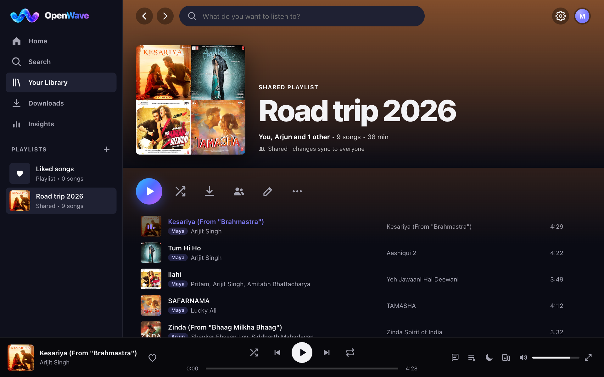<p align="center"><sub>A shared playlist: each song shows who added it</sub></p></td>
    <td width="38%">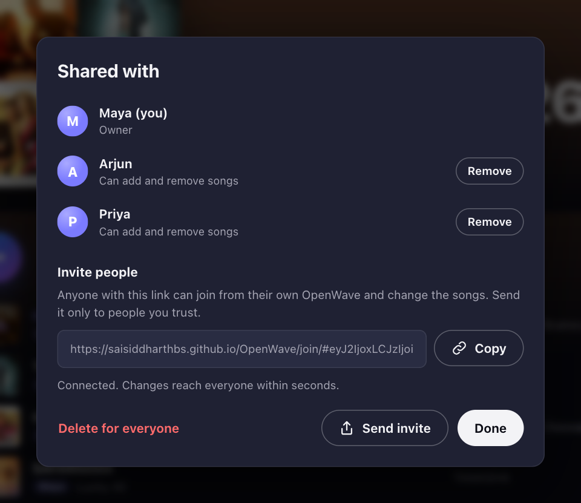<p align="center"><sub>Who's in it, and the invite link</sub></p></td>
  </tr>
</table>

<p align="center">
  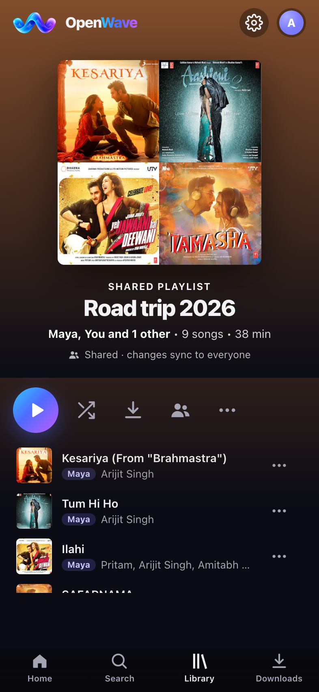
  &nbsp;
  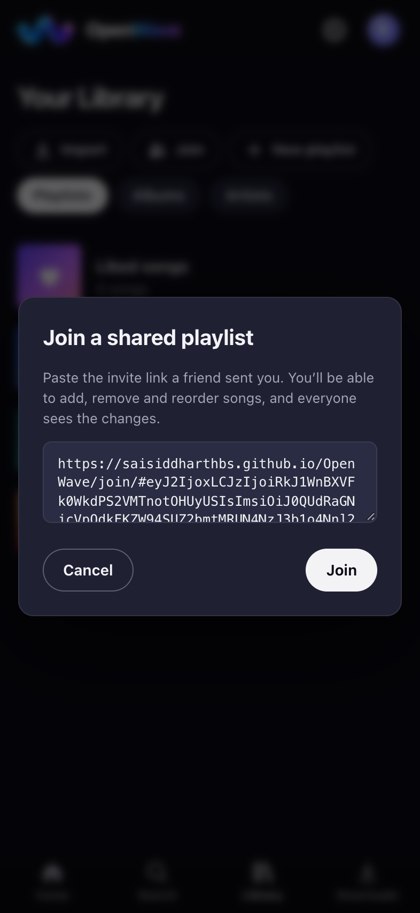
</p>
<p align="center"><sub>The same playlist on a friend's phone, and joining from an invite link.</sub></p>

### Devices: play anywhere, listen together

OpenWave apps on the same Wi-Fi find each other automatically, with no account and no server in between.

- **Play on another device.** Open the devices menu in the player and pick a device: the music moves there and continues from the same second. The device you are holding becomes the remote, with play, pause, skip, seek, volume, the queue, and anything you choose to play. One tap brings the music back.
- **Listen together.** Start a listening session and anyone on the Wi-Fi can join from their own phone or computer. Everyone hears the same song at the same moment, kept within a few hundredths of a second, and anyone in the session can pause, skip or add songs.
- **Private by default.** A device has to be approved once, with a prompt on its own screen, before another device can control it or join its session. Approved devices can be removed at any time, and any device can be hidden from the network.

<table>
  <tr>
    <td width="50%">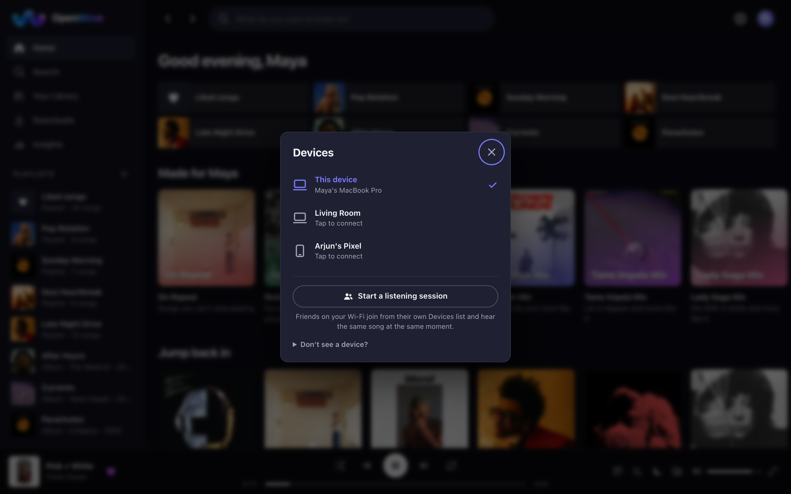<p align="center"><sub>Every OpenWave on your Wi-Fi, one tap away</sub></p></td>
    <td width="50%">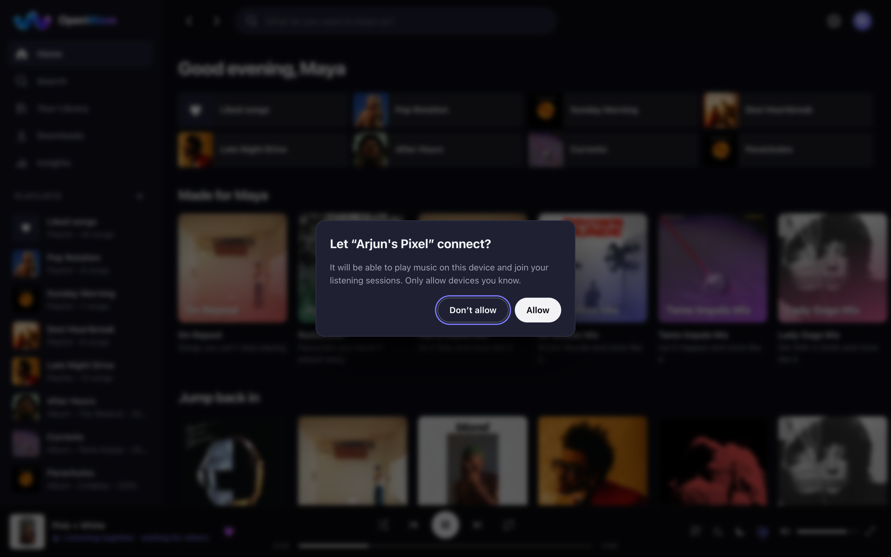<p align="center"><sub>Devices must be approved once before they can connect</sub></p></td>
  </tr>
</table>

<p align="center">
  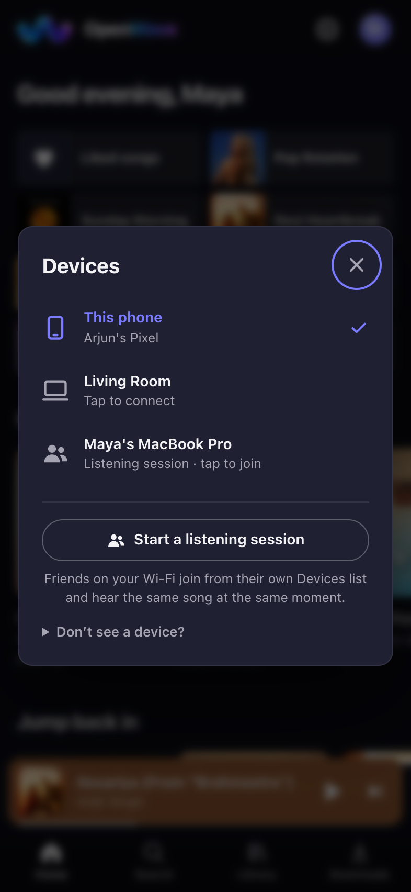
  &nbsp;
  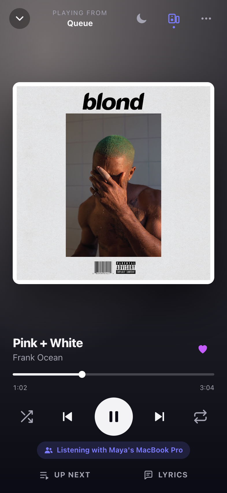
  &nbsp;
  
</p>
<p align="center"><sub>Left to right: choosing a device, a phone in a listening session with a Mac, and a phone acting as the remote for the living-room computer.</sub></p>

### Bring your playlists

Go to **Library → Import** (or press <kbd>⌘</kbd><kbd>⇧</kbd><kbd>I</kbd> on a Mac). There is no song limit.

| Service | Paste a link | Import a file (every song, every playlist) |
|---|---|---|
| **Spotify** | First 100 songs (the most Spotify shares publicly) | [Exportify](https://exportify.app) CSV, or Spotify's own *Download your data* |
| **YouTube / YouTube Music** | Every song | Google Takeout CSV |
| **Apple Music** | Playlists and albums | Music app → File → Library → *Export Playlist* (text or XML) |
| **Deezer** | Every song | — |
| **JioSaavn** | Yes | — |
| **Amazon Music, Tidal, SoundCloud and others** | — | [TuneMyMusic](https://www.tunemymusic.com) *Export to file*, or a Soundiiz CSV |
| **Anything else** | — | A pasted list with one `Artist - Title` per line |

OpenWave matches each song on YouTube Music by title, artist and length, and builds the playlist for you. A file with several playlists becomes several playlists. In testing, Spotify's "Today's Top Hits" imported 50 of 50 songs.

<p align="center">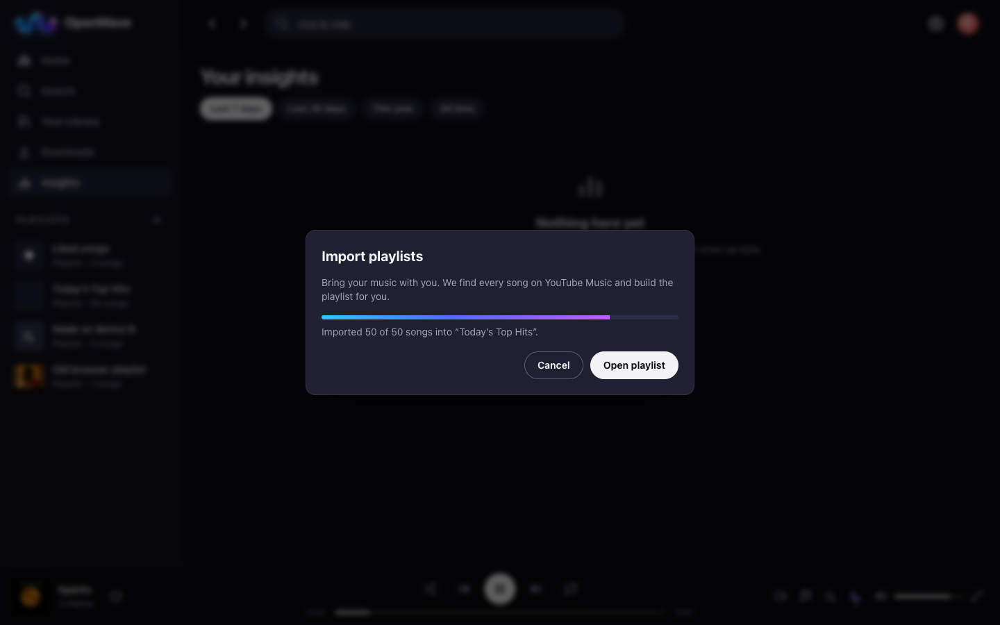</p>

<details>
<summary><b>More screenshots</b></summary>
<br>
<table>
  <tr>
    <td width="50%">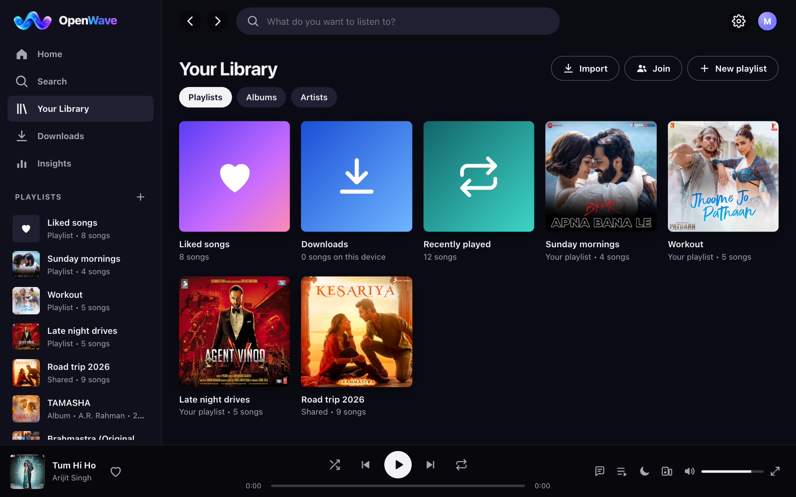<p align="center"><sub>Your Library</sub></p></td>
    <td width="50%">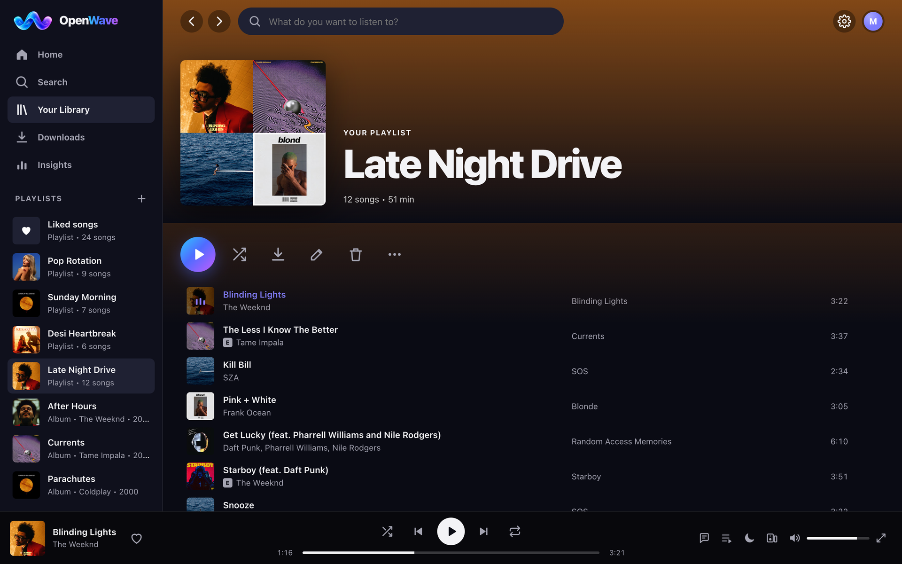<p align="center"><sub>A playlist, with downloads and editing</sub></p></td>
  </tr>
</table>
<p align="center">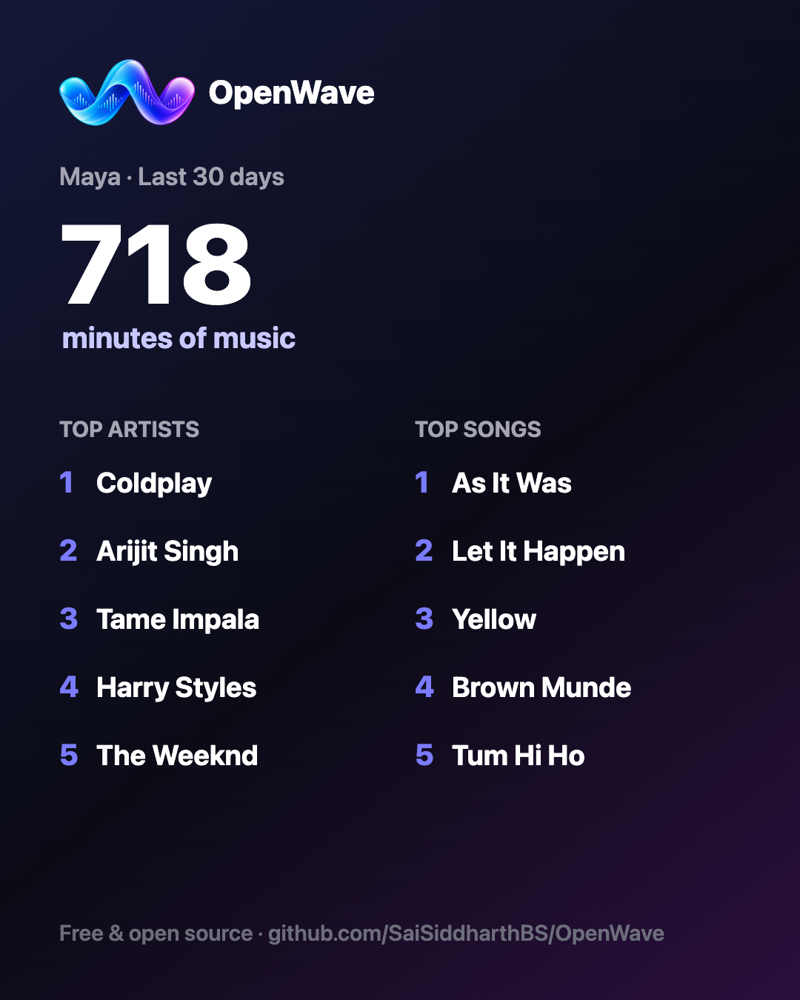<br><sub>The shareable insights card</sub></p>
</details>

## Platforms

### macOS

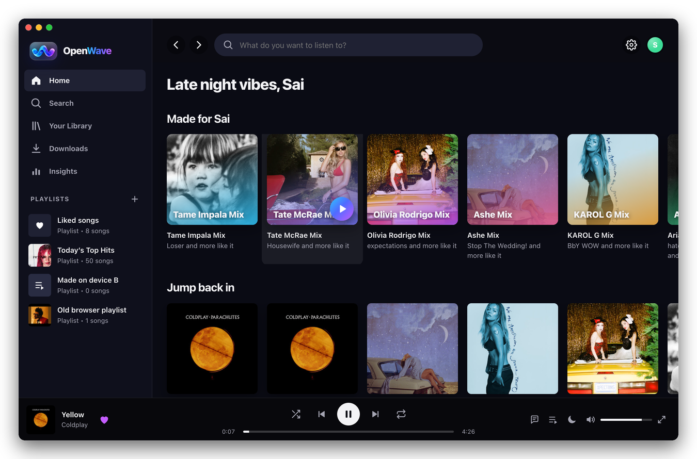

A native Swift app (AppKit and SwiftUI) that runs its own engine, with nothing to install or configure.

- **System integration:** media keys, Control Center and lock-screen controls with artwork, AirPods controls, song notifications and a Dock menu.
- **Menu-bar mini player**, so you can control the music without opening the window. Closing the window keeps the music playing.
- **Keyboard shortcuts:** <kbd>⌘</kbd><kbd>→</kbd> / <kbd>⌘</kbd><kbd>←</kbd> next and previous, <kbd>⌘</kbd><kbd>L</kbd> like, <kbd>⌘</kbd><kbd>F</kbd> search, <kbd>⌘</kbd><kbd>1</kbd>–<kbd>5</kbd> sections, <kbd>⌘</kbd><kbd>⇧</kbd><kbd>I</kbd> import.
- **Phone access** from Settings → Phone, privately from anywhere through Tailscale or on the home Wi-Fi, with a QR code to scan.
- **Self-installing updates**, verified by SHA-256 before the app replaces itself.
- **Deep links** such as `openwave://play/<videoId>`, and launch at login.

<p align="center">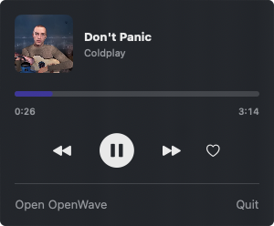<br><sub>The menu-bar mini player</sub></p>

> **About the macOS security prompt.** OpenWave is not notarised with a paid Apple Developer ID. macOS may ask for confirmation at first launch, depending on how the app was downloaded and installed. The install script verifies the published checksum; it is not a substitute for reviewing a downloaded app before running it. Signed and notarised builds remain on the [roadmap](#roadmap).

### Android

A native Kotlin app that runs the complete engine on the phone through [Chaquopy](https://chaquo.com/chaquopy/). No computer is needed.

- Media notification, lock-screen, headphone and Bluetooth controls; pauses for calls and when headphones are unplugged; keeps playing in the background.
- **Home-screen widget** with artwork and playback controls.
- Native-feeling navigation: page transitions, swipe the player down to close, swipe the artwork to change songs, long-press for a song's menu, haptic feedback and a back button that behaves as expected.
- Open YouTube and YouTube Music links shared from other apps.
- **Library location:** keep the library on the phone, or connect to OpenWave on your computer to share one library everywhere.

<p align="center">
  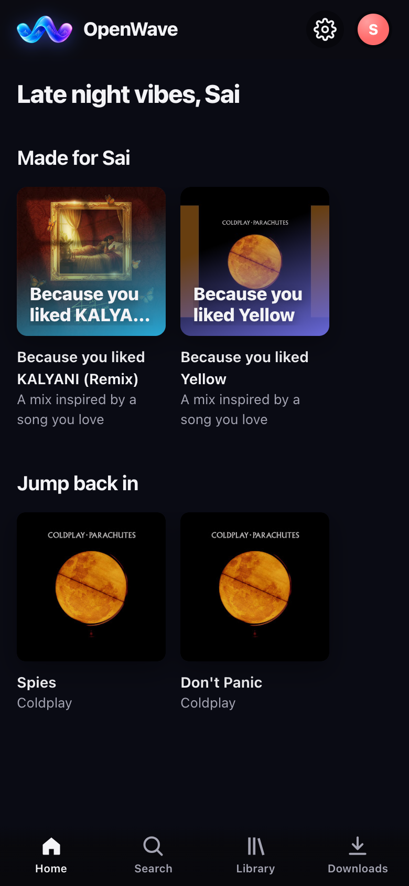
  &nbsp;
  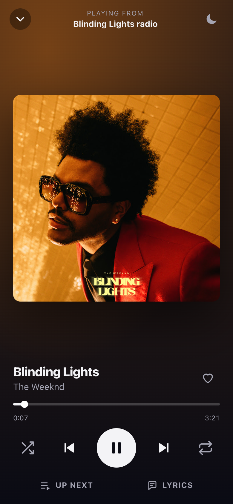
  &nbsp;
  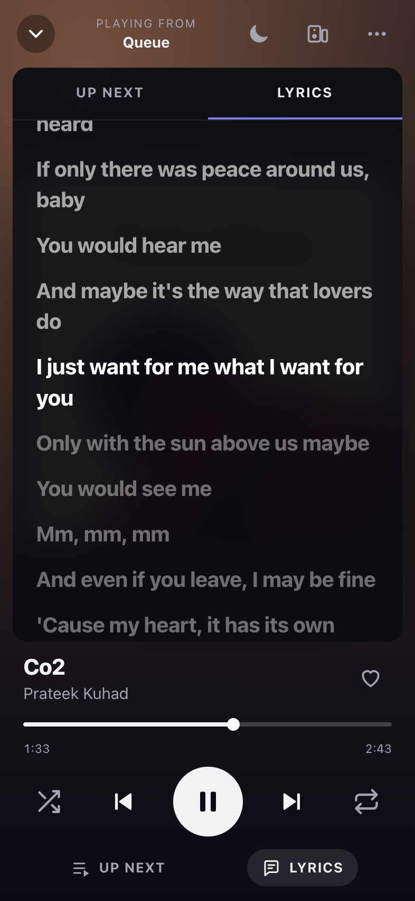
  &nbsp;
  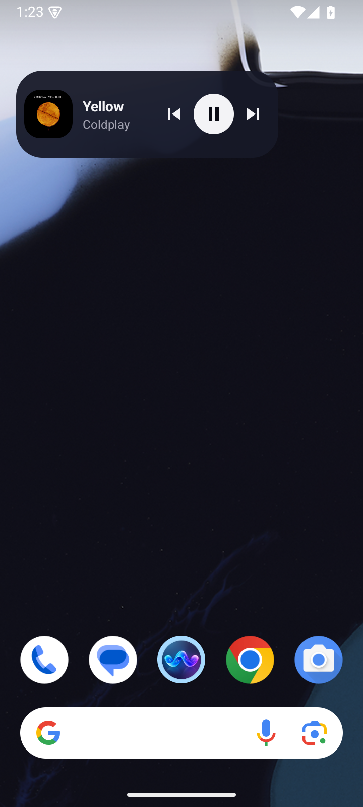
</p>

### iPhone

Apple does not allow apps like OpenWave on the App Store, so the iPhone plays from OpenWave running on your Mac, PC or server, with the same profiles, playlists and likes, installed as an app on the Home Screen.

**Anywhere, with offline downloads (recommended).** Free, and takes about three minutes once.

1. Install [Tailscale](https://tailscale.com/download) on the Mac and on the iPhone, signed in to the same account.
2. On the Mac, open **OpenWave → Settings → Phone → Anywhere → Turn On**. A QR code appears.
3. Scan it with the iPhone camera, then in Safari choose **Share → Add to Home Screen**.

<p align="center">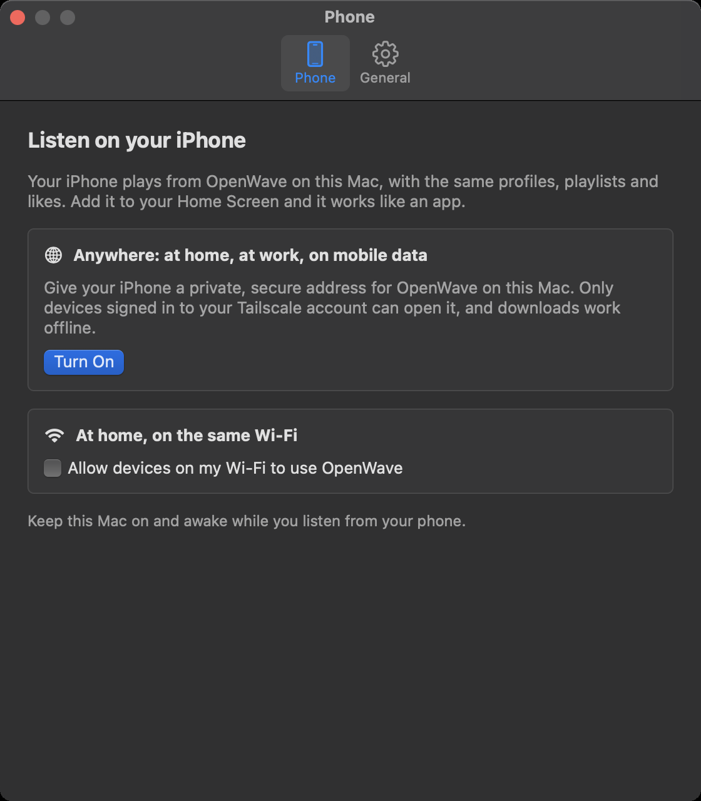</p>

OpenWave gets a private HTTPS address that only your own devices can open. It works at home, at work and on mobile data; downloads play offline; and the lock screen shows playback controls. The Mac needs to be on and awake while you listen.

**At home only.** Settings → Phone → **At home**, then scan the QR code on the same Wi-Fi. Offline downloads require the "Anywhere" option, because browsers only allow them over HTTPS.

On a home server or PC without the Mac app, `tailscale serve 8787` provides the same private HTTPS address. A Cloudflare Tunnel or a reverse proxy such as [Caddy](https://caddyserver.com) also works.

<p align="center">
  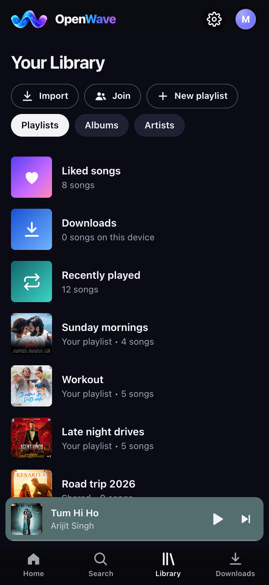
  &nbsp;
  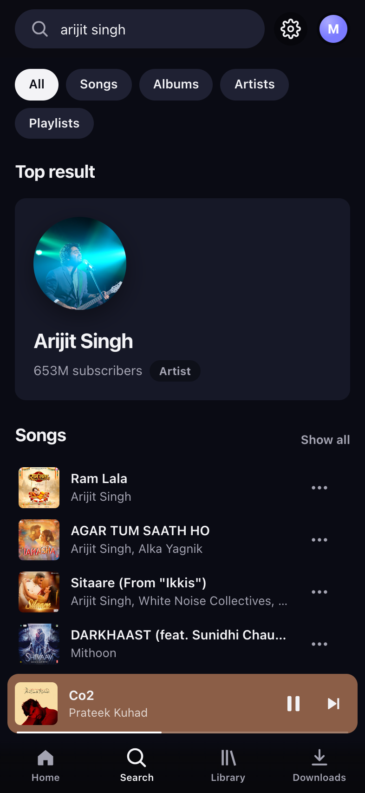
  &nbsp;
  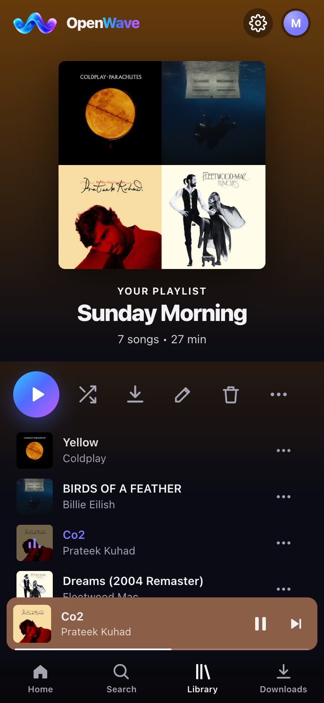
  &nbsp;
  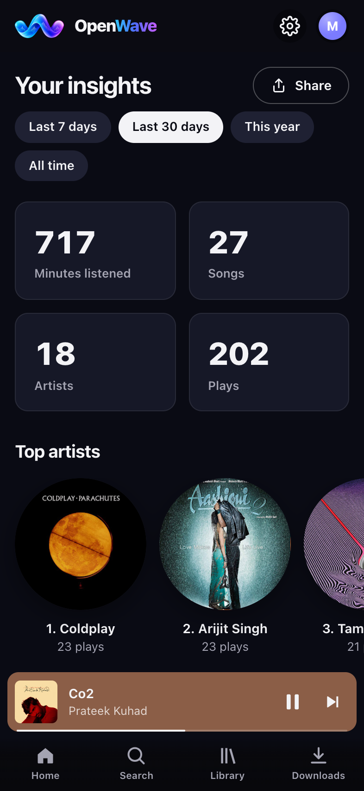
</p>

### Windows and Linux

One-click apps that bundle the same engine with a small launcher (`openwave/launcher.py`), which opens OpenWave in its own window using Microsoft Edge on Windows or Chrome/Chromium on Linux. They include in-app updates and self-updating YouTube support.

## Architecture

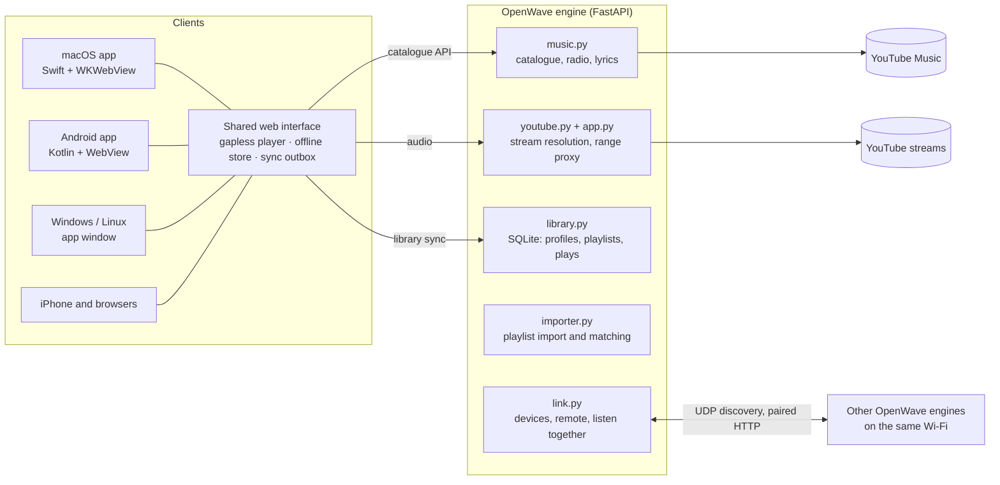

- **One engine, many shells.** The engine is a FastAPI application. Each platform wraps the same web interface in a native shell (Swift on macOS, Kotlin on Android, an app window on Windows and Linux) that adds system integration such as media keys, notifications and widgets.
- **Streaming.** YouTube ties stream URLs to the address that requested them, so the engine proxies audio with HTTP range requests. Client devices never contact Google directly. Long songs are fetched from YouTube in pieces behind the scenes and resumed from the exact byte if the connection drops.
- **Library and sync.** Each profile's library is a set of operations applied to SQLite. Clients apply changes optimistically, keep an outbox while offline, and sync it when they reconnect; other devices poll a version number and pick changes up within seconds.
- **Devices.** Engines on the same network discover each other with a UDP broadcast, and talk over a separate, small listener (ports 47880–47889) that only serves the device routes. Pairing issues a bearer token whose hash is stored on the approving device. Only "what's playing" is shared; each device streams its own audio, and listeners stay in step by playing marginally faster or slower rather than skipping.
- **Songs, not videos.** When YouTube returns a music video, the engine looks up its audio-track version, and radios are started from songs.

## Self-hosting

Run the engine once on a PC, Mac, home server or VPS, then open OpenWave from any device in the house.

**Docker** (amd64 and arm64)

```bash
docker run -d --name openwave -p 8787:8787 \
  -v openwave:/data --restart unless-stopped \
  ghcr.io/saisiddharthbs/openwave
```

Or, from a clone of this repository: `docker compose up -d --build`.

**From source** (Python 3.10+, plus [Deno](https://deno.com) or Node.js 20+ for YouTube's player scripts)

```bash
git clone https://github.com/SaiSiddharthBS/OpenWave.git && cd OpenWave
./scripts/start.sh                 # Windows: scripts\start.bat
```

**With pip**

```bash
pip install git+https://github.com/SaiSiddharthBS/OpenWave.git
openwave --host 0.0.0.0 --port 8787 --no-browser
```

<details>
<summary><b>Configuration</b></summary>

| Variable | Effect |
|---|---|
| `OPENWAVE_DATA` | Where profiles and libraries are stored. Defaults to the platform's app-data folder; `/data` in Docker. |
| `OPENWAVE_LOCATION` | Region for recommendations, for example `US`, `IN` or `GB`. |
| `OPENWAVE_LANGUAGE` | Metadata language, for example `en`, `hi` or `es`. |
| `OPENWAVE_LINK` | `1` makes the device visible to other OpenWave devices on the network from the start. The Mac and Android apps set this; it can also be changed in Settings → Devices. |
| `OPENWAVE_DEVICE_NAME` | The name other devices see. Defaults to the computer's name. |
| `OPENWAVE_RELAYS` | Comma-separated `wss://` Nostr relays that shared playlists sync through, or `off` to keep shared playlists on this server only. Defaults to six public relays. |

</details>

<details>
<summary><b>HTTP API</b> (interactive documentation at <code>/api/docs</code>)</summary>

| Endpoint | Returns |
|---|---|
| `GET /api/search?q=&type=all\|songs\|albums\|artists\|playlists` | Normalised search results |
| `GET /api/home` · `/api/album/{id}` · `/api/playlist/{id}` · `/api/artist/{id}` | Catalogue pages |
| `GET /api/next/{videoId}` · `/api/lyrics/{videoId}` | Radio and lyrics |
| `GET /api/stream/{videoId}?q=&codec=opus\|aac` · `/api/download/{videoId}` | Audio |
| `GET /api/audio/{videoId}` | The song (audio-track) version of any video |
| `GET/POST /api/profiles` · `POST /api/profiles/{id}/login` | Profiles and sign-in |
| `GET /api/me/library` · `POST /api/me/ops` · `GET /api/me/version` | Library sync |
| `GET /api/me/stats` · `/api/me/mixes` · `/api/me/smart` · `/api/me/radio/{videoId}` | Insights, mixes, On Repeat and Rediscover, personal radio |
| `POST /api/import/parse` · `/api/import/match` | Playlist import |
| `/api/link/*` | Devices, remote control and listening sessions |
| `GET /api/app-update` | Whether a newer release exists, and the right file for this device |

</details>

## Privacy and security

- **No telemetry.** The apps never report usage, crashes or identifiers. The public [Stats page](https://saisiddharthbs.github.io/OpenWave/stats.html) is built only from GitHub's public numbers: downloads per file, version and day, and stars.
- **Local data.** Libraries live in SQLite on the device or server you run. Client devices talk only to your engine, never to Google.
- **Shared playlists are end-to-end encrypted.** OpenWave runs no servers, so a shared playlist syncs through a few free, public [Nostr](https://nostr.com) relays. Each member's OpenWave publishes its copy encrypted with a key that exists only in the invite link (after the `#`, which browsers never send to a server). Relays see only encrypted data, a random identity per profile and your IP address, never song names or who you are. Owner-only changes are signed by the owner. Nothing is sent to a relay unless you share or join a playlist. Self-hosters can choose relays with `OPENWAVE_RELAYS` (or `off`).
- **Device pairing.** Devices on the network can see each other's names, but cannot play anything or join a session until approved on the target device's own screen. Only playback state crosses the network: no audio, and no library data.
- **Remote access stays private.** The "Anywhere" phone option uses Tailscale, so the address is reachable only by devices signed in to your own Tailscale account, over HTTPS.
- **Verified releases.** Every installer ships with a SHA-256 checksum, which the Mac installer and the Mac app's updater verify before installing. Android releases are signed with a single, stable key.

## Development

```bash
python -m venv .venv && .venv/bin/pip install -e ".[dev]"
.venv/bin/python -m openwave --no-browser      # http://localhost:8787
.venv/bin/pytest                               # 40 tests
```

The web interface in `openwave/web/` is plain HTML, CSS and ES modules with no build step: edit and reload.

| Path | Contents |
|---|---|
| `openwave/` | The engine: API, streaming, library, import, devices, updates |
| `openwave/web/` | The interface shared by every platform |
| `macos/` | Native macOS app (Swift) and `build.sh` |
| `android/` | Native Android app (Kotlin, Chaquopy) |
| `packaging/` | Windows installer and Linux AppImage |
| `site/` | Website, Mac installer script and Stats page, deployed to GitHub Pages |
| `scripts/` | Start scripts, release tooling and statistics collection |
| `.github/workflows/` | CI, platform builds, releases, Pages and daily statistics |

**Continuous integration.** Every push and pull request runs the test suite; pull requests that touch the engine or an app also build the Mac and Android apps and test the Android app on an emulator. Tagging a release builds the macOS (Apple Silicon and Intel), Windows, Linux and Android apps and the multi-architecture Docker image, and publishes them as one release with checksums and notes. See [MAINTAINING.md](MAINTAINING.md).

## Roadmap

- [x] Native apps for macOS, Windows, Linux and Android
- [x] Profiles, sync, personal mixes and insights
- [x] Playlist import from Spotify, Apple Music, YouTube Music, Deezer, JioSaavn and export files
- [x] In-app updates on every platform
- [x] Play on another device and listen together on the same Wi-Fi
- [x] iPhone access from anywhere through Tailscale
- [ ] Listen together over the internet
- [ ] Distribution on F-Droid and IzzyOnDroid
- [ ] Notarised macOS and signed Windows builds
- [ ] Equaliser and loudness normalisation
- [x] Shared playlists with friends and family on any device, anywhere
- [ ] Translations

Release history is in [CHANGELOG.md](CHANGELOG.md). Ideas and requests are welcome in [issues](https://github.com/SaiSiddharthBS/OpenWave/issues).

## FAQ

<details>
<summary><b>Is OpenWave a commercial product?</b></summary>

No. It is free and open-source software under the GPL-3.0, with nothing to buy and no paid tier, and it will not be monetised.
</details>

<details>
<summary><b>Do I need an account?</b></summary>

No. Profiles are names with an optional PIN, stored on your own device or server. There is no email address and no sign-up.
</details>

<details>
<summary><b>Why isn't it on the App Store or Google Play?</b></summary>

Both stores reject apps that play YouTube content, which is why projects such as NewPipe are distributed directly. OpenWave is downloaded from GitHub or [the website](https://saisiddharthbs.github.io/OpenWave/), and its source is open for anyone to review. On Android, [Obtainium](https://github.com/ImranR98/Obtainium) provides store-style automatic updates.
</details>

<details>
<summary><b>Does it play music videos?</b></summary>

No, by design. OpenWave always plays the song itself.
</details>

<details>
<summary><b>Playback stopped working for every song.</b></summary>

YouTube changes occasionally. The desktop apps update their YouTube support automatically in the background; restart the app to apply it. On a server, run `pip install -U "yt-dlp[default]" ytmusicapi` (the start scripts do this automatically) or pull the latest Docker image.
</details>

<details>
<summary><b>Can someone else on my Wi-Fi take over my music?</b></summary>

No. Other devices can see your device's name, but a device must be approved once, on your screen, before it can play anything or join your session. Remove devices at any time in **Settings → Devices**, or turn off **Show this device on Wi-Fi** to hide it. The Mac and Android apps start visible; Windows, Linux, Docker and the server start hidden.
</details>

<details>
<summary><b>How many people use OpenWave?</b></summary>

The [Stats page](https://saisiddharthbs.github.io/OpenWave/stats.html) shows downloads per platform, per version and per day, and stars, from GitHub's public numbers. OpenWave does not count active users, because the apps do not report anything.
</details>

## Contributing

Contributions of every kind are welcome: code, design, translations, documentation and bug reports. Start with [CONTRIBUTING.md](CONTRIBUTING.md), and please read the [Code of Conduct](CODE_OF_CONDUCT.md). Security issues should be reported privately, as described in [SECURITY.md](SECURITY.md).

## Acknowledgements

OpenWave is built on [yt-dlp](https://github.com/yt-dlp/yt-dlp), [ytmusicapi](https://github.com/sigma67/ytmusicapi), [FastAPI](https://fastapi.tiangolo.com), [Deno](https://deno.com), [PyInstaller](https://pyinstaller.org) and [Chaquopy](https://chaquo.com/chaquopy/), and inspired by [NewPipe](https://newpipe.net), [FreeTube](https://freetubeapp.io) and [Invidious](https://invidious.io).

## Legal and responsible use

- **OpenWave hosts no content.** It is a client for content that YouTube makes publicly available, built on the same open-source libraries as other community projects such as yt-dlp and NewPipe. It does not store, redistribute or sell music.
- **Non-commercial.** OpenWave is not monetised and never will be. It is intended for personal use.
- **Respect the rights of others.** You are responsible for using OpenWave in line with the terms of the services it connects to and the copyright law of your country. Using third-party clients may conflict with YouTube's Terms of Service. Please support the artists you listen to through official channels.
- **Not affiliated.** OpenWave is an independent project, not affiliated with, endorsed by or connected to YouTube, Google, Spotify or any record label. Product names are used only to describe compatibility.
- **Rights holders** with a concern can [open an issue](https://github.com/SaiSiddharthBS/OpenWave/issues/new/choose) or reach the maintainer privately through the repository's [private reporting form](https://github.com/SaiSiddharthBS/OpenWave/security/advisories/new); concerns are reviewed promptly.

## License

[GNU General Public License v3.0 or later](LICENSE).
